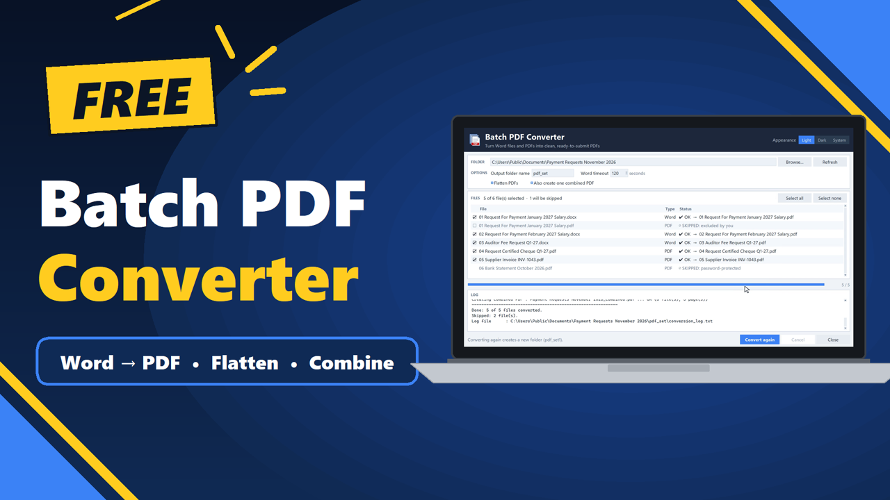
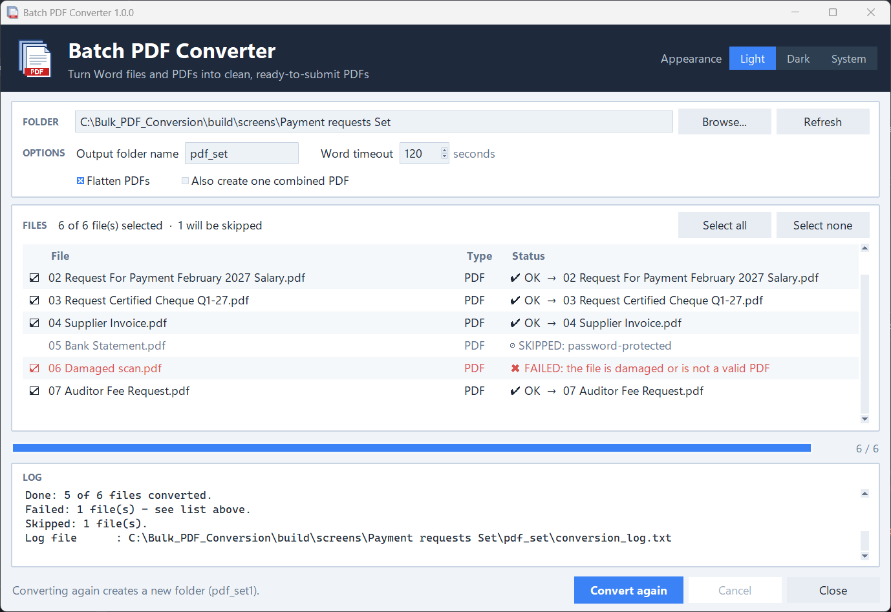

# Batch PDF Converter

**Turn Word files and PDFs into clean, ready-to-submit PDFs, a whole folder at once.**
Free, for Windows 10 and 11. Nothing to install, no account, no internet needed. Your documents never leave your computer.

▶ **Watch the video tutorial first:** [YouTube tutorial](https://youtu.be/6J9USMwdhtY) on **Happy Learning-GP**

⬇ **[Download Batch-PDF-Converter.zip](https://github.com/ganapap1/batch-pdf-converter/releases/latest/download/Batch-PDF-Converter.zip)**

## What it does

- **Word to PDF:** converts every `.docx` and `.rtf` file in a folder to PDF, using Microsoft Word.
- **Flattens PDF forms:** filled-in values are burned into the page, so nobody can change them later.
- **Keeps your names and order:** each PDF keeps its original file name. Number your files `01`, `02` and so on to control the order.
- **Never touches your originals:** every run creates a new folder inside your folder (`pdf_set`, then `pdf_set1`, `pdf_set2` ...).
- **One combined PDF (optional):** everything in a single file, in the same order, with a bookmark for each document.
- **A clear report:** what was converted, and what was skipped or failed, with the reason (for example *password-protected*).
- **Light, Dark and System** appearance.

Ideal for monthly payment request packs, and any set of documents you need to submit as PDFs.

## Start in 3 steps (Windows 10 or 11)

1. **Download** [Batch-PDF-Converter.zip](https://github.com/ganapap1/batch-pdf-converter/releases/latest/download/Batch-PDF-Converter.zip).
2. **Extract** it.
   - Right-click the ZIP → **Extract All…** → **Extract**.
   - **Tip:** before extracting, right-click the ZIP → **Properties**, tick **Unblock**, then **OK**.
   - The program doesn't work from inside the ZIP. Keep all the files in the extracted folder together.
3. In the extracted folder, **double-click `Batch PDF Converter.exe`**.
   - The first time, Windows may say **"Windows protected your PC"**. That's normal for a new program: click **More info**, then **Run anyway**.

Then click **Browse...** (or drag a folder onto the window), check the list, and click **Convert**.

## Good to know

- **Microsoft Word** is needed for Word files. PDFs work without it.
- Only the files directly in the folder you choose are converted. Sub-folders, including earlier `pdf_set` folders, are ignored.
- Each output folder contains `conversion_log.txt`, listing every file and what happened to it.
- **Your antivirus removed or blocked the program?** It's a false alarm: the program isn't signed by a publisher. Ask your IT support to allow it.

## Licence

[MIT](LICENSE) © 2026 Ganapathy Palanimuthu · **Happy Learning-GP**
